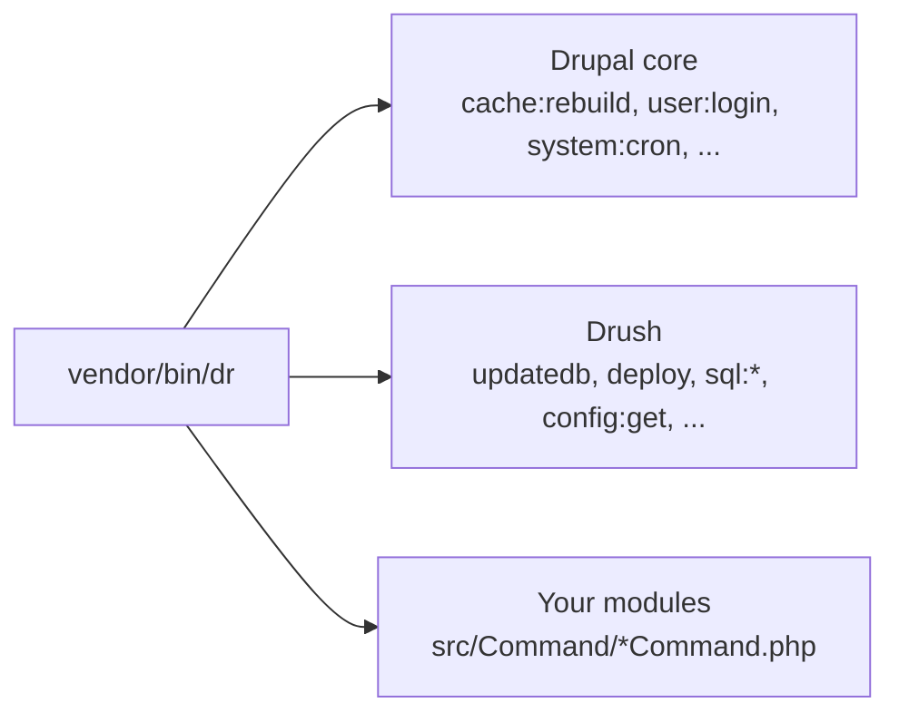

Drush can be run in your shell by typing `dr` from within your project root directory or anywhere within Drupal.

    $ dr [options] <command> [argument1] [argument2]

Use the [help command](commands/help.md) to get a list of available options and commands:

    $ dr help pm:list

Drush needs to be told the domain of your site in order for commands to generate correct links (e.g. user:login). You may set a `DRUPAL_URI` environment variable, or use the `--url` option.

    $ dr --url=http://example.com user:login

Where commands come from
------------------------

`dr` belongs to Drupal core. Drush and your modules add commands to it.

Run `dr list` to see what is available on your site. The list depends on the site's state:

- Before Drupal is installed, Drush adds only commands that need no installed site, such as [sql:cli](commands/sql_cli.md) and [php:eval](commands/php_eval.md).
- Some Drush commands appear only when their module is installed: `watchdog:*` (dblog), `image:*` (image), `jn:get` (jsonapi), `workspace:publish` (workspaces).
- When Drupal core ships a command, Drush steps aside and core's version runs. This applies to `config:export`, `config:import`, `ex:install` and `ex:uninstall` on newer core versions.
